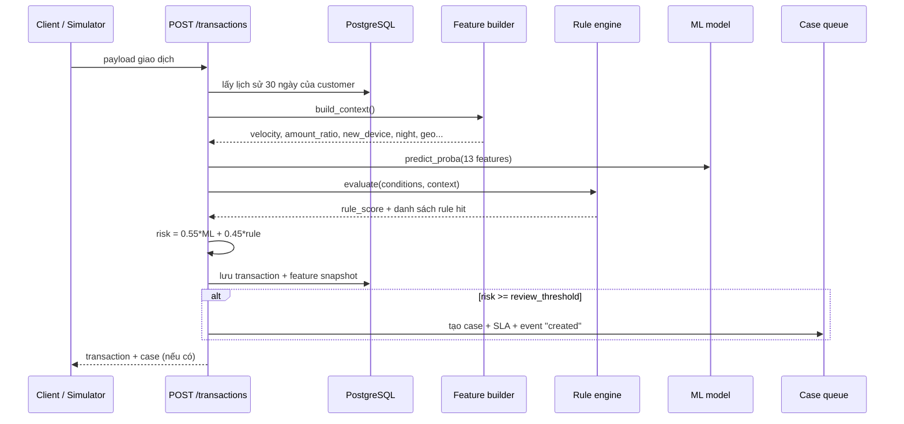
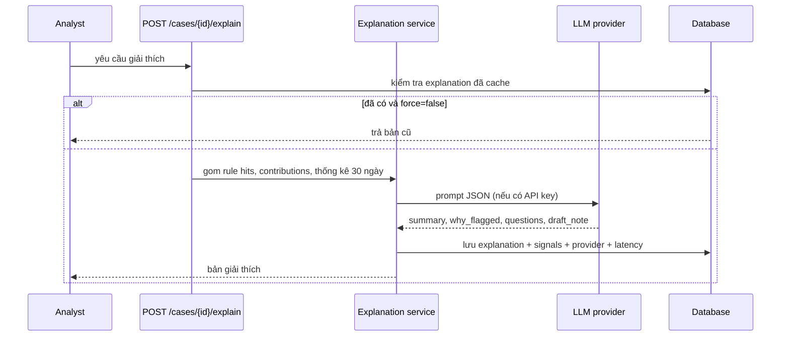

# Kiến trúc FraudLens

## 1. Thành phần

| Thành phần | Vai trò |
|---|---|
| React SPA (`frontend/`) | Dashboard, hàng chờ, case detail, rule builder, user, audit, settings |
| FastAPI (`app/`) | REST API, auth/RBAC, ingest, scoring, case workflow, audit |
| PostgreSQL | Lưu user, giao dịch, case, note, event, explanation, rule, audit, refresh session |
| ML artifact (`app/ml/artifacts/`) | Model HistGradientBoosting + metadata (AUC, baseline, feature importance) |
| AI provider | OpenAI/Anthropic tuỳ cấu hình; fallback template offline |
| Static hosting | FastAPI serve `frontend/dist` (SPA fallback) |

## 2. Luồng ingest & chấm điểm



Điểm quan trọng: **feature snapshot được lưu lại** cùng giao dịch, nên sau này analyst xem lại đúng ngữ cảnh tại thời điểm chấm, kể cả khi lịch sử khách hàng đã thay đổi.

## 3. Công thức điểm

```text
rule_score = min(Σ weight(rule khớp), 100)
risk_score = round(ml_score × ml_weight + rule_score × rule_weight, 1)
```

- `ml_score = predict_proba × 100`
- `ml_weight + rule_weight = 1` (API validate khi admin lưu cấu hình)
- Band: `critical ≥ high_threshold`, `high ≥ review_threshold`, `medium ≥ review_threshold × 0.65`, còn lại `low`
- Case chỉ được tạo khi `risk_score ≥ review_threshold`
- Priority: P1 nếu risk ≥ 85 hoặc amount ≥ 40 triệu; P2 nếu risk ≥ 68 hoặc amount ≥ 10 triệu; còn lại P3. SLA tương ứng 4h / 12h / 48h.

## 4. Case workflow

```
open ──► in_review ──► awaiting_info ──► resolved
  │           │               │
  └───────────┴───────────────┴──► decision (chỉ analyst/admin)
```

- `resolved` chỉ đặt được khi đã có `decision` (API chặn).
- `decision` gồm `confirmed_fraud`, `false_positive`, `escalated`; lưu kèm note ≥ 10 ký tự.
- Mỗi hành động tạo `CaseEvent` (timeline) và `AuditLog` (before/after).
- Decision đã ghi **không thể ghi đè**; API trả 409.

## 5. Giải thích AI



Nếu không có key hoặc provider lỗi, service dùng template tiếng Việt dựng từ chính các tín hiệu. UI luôn gắn nhãn **“Bản nháp AI — chưa xác nhận”** và disclaimer.

## 6. Mô hình dữ liệu

| Bảng | Nội dung chính |
|---|---|
| `users` | email (unique, có unique index `lower(email)`), role, password hash scrypt, active, last login |
| `merchants` | danh mục merchant: tên, ngành, quốc gia, risk tier |
| `transactions` | payload gốc + `merchant_id` FK + feature snapshot + ML/rule/risk score + rule hits + contributions |
| `cases` | mã case, priority, status, decision, assignee, SLA, risk score |
| `case_notes` | ghi chú analyst, ghi chú AI, ghi chú decision |
| `case_events` | timeline của case |
| `explanations` | nội dung AI/offline, provider, model, latency |
| `rules` | điều kiện JSONB, weight, severity, enabled, hit count |
| `audit_logs` | actor, action, entity, before/after, IP, UA — append-only |
| `refresh_sessions` | hash refresh token, hết hạn, revoked |

Các cột JSON (`rule_hits`, `contributions`, `conditions`, `meta`, `content`, `signals`,
`before`, `after`) dùng **JSONB** để kiểm tra kiểu, index và truy vấn hiệu quả hơn `json`.

`transactions` giữ cả `merchant_id` (chuẩn hoá, tham chiếu `merchants`) và snapshot
`merchant_name/category/country`. Snapshot là chủ đích: audit phải tái lập được dữ liệu tại thời
điểm chấm điểm, kể cả khi merchant đổi thông tin master.

### 6.1. Ràng buộc & index

- **CHECK constraint** cho enum nghiệp vụ (`role`, `risk_tier`, `channel`, `risk_band`,
  `priority`, `status`, `decision`, `severity`, `kind`) và các khoảng số (score 0–100,
  amount > 0, hour 0–23, velocity/amount_ratio/account_age ≥ 0).
- **CHECK chéo**: case `resolved` bắt buộc có `decision` + `resolved_at`; settings chỉ có
  `id = 1`, `high_threshold > review_threshold`, trọng số trong 0–1 và tổng > 0; rule phải có
  `conditions` là JSON array không rỗng.
- **Khoá ngoại có `ON DELETE`**: case/note/event/explanation thuộc case dùng `CASCADE`;
  tham chiếu user dùng `SET NULL` để giữ lịch sử; `refresh_sessions.user_id` dùng `CASCADE`;
  `transactions.merchant_id` dùng `SET NULL`.
- **Index composite/partial** theo truy vấn nóng: `(customer_id, occurred_at)`,
  `(risk_band, occurred_at)`, `(channel, occurred_at)`, partial index giao dịch bị gắn cờ,
  `(status, sla_due_at)`, partial index case chưa resolved, `(case_id, created_at)` cho
  note/event/explanation, `(action|entity_type|actor_id, created_at)` cho audit.
- **Audit bất biến**: trigger `trg_audit_logs_immutable` chặn `UPDATE`/`DELETE` trên
  `audit_logs`; audit không đặt FK tới `users` để không mất dấu khi user bị xoá.
- **Sinh mã case an toàn**: `next_case_code()` lấy advisory lock theo transaction và tăng từ
  mã lớn nhất, tránh trùng khi nhiều request ingest đồng thời.

## 7. Bảo mật

- JWT HS256 access token 45 phút; refresh token 7 ngày lưu **hash** trong DB.
- Refresh cookie `HttpOnly`, `SameSite=Lax`, `Secure` khi production.
- RBAC kiểm tra ở dependency FastAPI, không chỉ ẩn UI.
- Rate-limit login theo email+IP (in-memory, 6 lần/5 phút).
- Security headers: `X-Frame-Options`, `X-Content-Type-Options`, `Referrer-Policy`, `Permissions-Policy`, `Cache-Control: no-store` cho API.
- Input validation bằng Pydantic; rule condition whitelist field/op.
- Không log secret; API key chỉ đọc từ env.

## 8. Triển khai

- Docker multi-stage: Node build SPA → Python runtime chỉ chứa artifact + dist.
- Render blueprint tạo Postgres + web service, health check `/api/health`.
- PostgreSQL là backend chính cho cả dev lẫn production (`psycopg` 3). Dev dùng bản PostgreSQL
  cài trên Windows (`scripts/windows-db.ps1`, 127.0.0.1:5432, database `fraudlens`); máy không
  cài sẵn có thể dùng cluster riêng `.pgdata/` qua `scripts/dev-db.ps1` (127.0.0.1:5433).
- PostgreSQL là database duy nhất — app, bộ test và CI đều chạy trên PostgreSQL
  (test dùng database riêng `fraudlens_test`, conftest xoá & tạo lại schema mỗi lần chạy).
- Cột thời gian dùng `UTCDateTime` (`app/models.py`): luôn lưu/đọc UTC naive để logic so sánh
  với `utcnow()` không lệch múi giờ (PostgreSQL trả aware cho cột `timestamptz`).
- Database mới tạo bằng `create_all`; database đã có dữ liệu được nâng cấp bằng
  `app/schema_migrations.py` (gọi trong `init_db()` hoặc chạy `scripts/migrate_db.py`).
- Seed tự động khi DB rỗng và `SEED_ON_START=true`; đặt `DEMO_MODE=false` khi triển khai thật.

## 9. Quyết định thiết kế

| Quyết định | Lý do |
|---|---|
| SPA React thay vì Streamlit/Dash | Yêu cầu auth, RBAC, phân trang, workflow nhiều bước và UI/UX hoàn chỉnh khó làm sạch trong Streamlit |
| Không dùng auto-encoder/LLM để chấm điểm | Cần minh bạch, giải thích được, ổn định; rule + GBDT phù hợp fraud tabular |
| Contribution heuristic thay vì SHAP | Giữ artifact nhẹ, triển khai nhanh; UI ghi rõ là ước lượng, không phải nhân quả |
| Lưu feature snapshot | Audit và tái lập quyết định tại thời điểm chấm |
| Offline explanation fallback | Demo và môi trường không có API key vẫn hoạt động đầy đủ |
| Rule cap 100 điểm | Tránh việc cộng dồn rule làm điểm vượt thang 100, giữ trọng số ML/rule có nghĩa |
