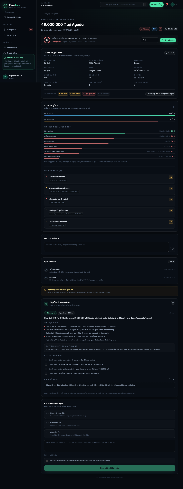
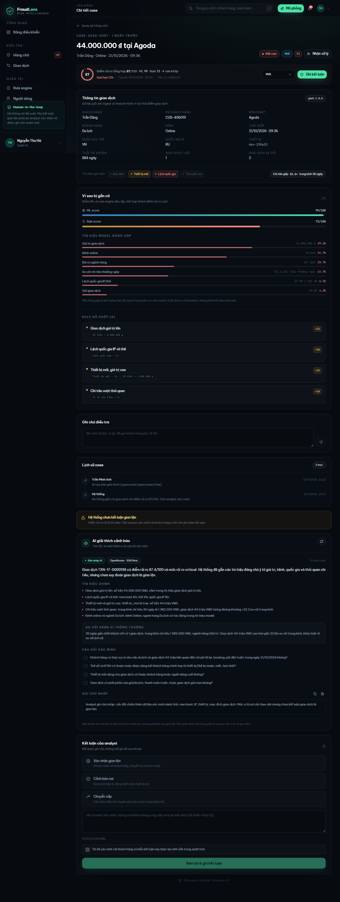

# Audit đối chiếu đề bài — FraudLens

Tài liệu này là **kết quả kiểm chứng thực tế** (không phải mô tả dự định) cho đề tài 10:
*Hệ thống chấm điểm rủi ro giao dịch có AI giải thích cảnh báo* (Data + AI — Fraud Analytics).

- Ngày audit: **19/11/2026**, cập nhật **20/11/2026** (bật LLM thật qua OpenRouter)
- Môi trường: Windows, Python 3.14.5, Node 24, PostgreSQL 18.4 (cổng 5433), Chromium
- Phiên bản: commit `8d40aa4` + các thay đổi chuyển sang PostgreSQL trong lần audit này

## 1. Kết luận nhanh

| Hạng mục | Kết quả |
|---|---|
| Chức năng nghiệp vụ (8/8 yêu cầu) | **ĐẠT** — đã kiểm chứng bằng test + thao tác thật trên UI |
| Dashboard, queue ưu tiên, audit trail | **ĐẠT** |
| Cơ chế không tự kết luận (human-in-the-loop) | **ĐẠT** — chặn ở API (400/409) + xác nhận 2 bước trên UI |
| Đăng nhập & phân quyền | **ĐẠT** — 3 vai trò, chặn cả ở API lẫn route UI |
| UI/UX hoàn chỉnh | **ĐẠT** — 9 trang, chart, empty/error state, responsive |
| Quản lý user | **ĐẠT** |
| Sản phẩm web hoàn chỉnh (không notebook/CLI) | **ĐẠT** — FastAPI + SPA build sẵn + PostgreSQL |
| PostgreSQL (theo yêu cầu mới của nhóm) | **ĐẠT** — 10/10 test chạy trên PostgreSQL |
| **Deployed online (có URL)** | **CHƯA ĐẠT** — chủ động giữ local theo yêu cầu; `render.yaml` + Docker đã sẵn sàng |

**Tổng: 20/21 yêu cầu đạt.** Yêu cầu còn thiếu là *URL công khai*, không phải lỗi kỹ thuật —
repo đã có đủ cấu hình để deploy trong ~10 phút (xem mục 5).

## 2. Đối chiếu từng yêu cầu trong đề

| # | Yêu cầu | Trạng thái | Bằng chứng (đã kiểm tra) |
|---|---|---|---|
| 1 | Ingest giao dịch | ĐẠT | `POST /api/transactions` (`app/routers/transactions.py`), modal “Nhập giao dịch”, simulator. Test `test_ingest_creates_flagged_case_and_audit`. |
| 2 | Tính feature hành vi | ĐẠT | `app/features.py` — 13 feature: velocity 1h/24h, tỷ lệ chi tiêu 30 ngày, thiết bị mới, lệch quốc gia IP/thẻ, giờ đêm (sin/cos), số merchant 24h, tuổi tài khoản, rủi ro ngành, kênh online. |
| 3 | Áp rule engine | ĐẠT | `app/rules.py` + `app/routers/rules.py` + trang Rules: 8 rule seed, bật/tắt, weight, severity, condition builder, whitelist field. Test `test_rule_crud_and_rbac`. |
| 4 | Mô hình phát hiện bất thường | ĐẠT | `app/ml/` — HistGradientBoosting, artifact `app/ml/artifacts/model.joblib` (381 KB), AUC **0.9769**, model card `docs/model-card.md`. |
| 5 | Chấm risk score | ĐẠT | `app/scoring.py`: `ml_score × 55% + rule_score × 45%` (cấu hình được), cap 100, band low/medium/high/critical. |
| 6 | Hiển thị case đáng ngờ | ĐẠT | `GET /api/cases` + trang Hàng chờ: 49 case mở, lọc theo trạng thái/ưu tiên/phụ trách, tìm kiếm, phân trang. |
| 7 | Analyst cập nhật trạng thái điều tra | ĐẠT | `PATCH /api/cases/{id}`, nhận xử lý, phân công, đổi trạng thái, timeline. Thao tác thật trên UI đã kiểm chứng. |
| 8 | AI tóm tắt vì sao bị gắn cờ | ĐẠT | `app/explain.py`: gọi LLM thật qua **OpenRouter** (`AI_BASE_URL`, tương thích OpenAI/Anthropic). Hiện cấu hình **chỉ dùng model free** (`openrouter/free` + 2 model dự phòng `:free`, tự chuyển khi gặp 429/timeout). Đã chạy thật, nội dung tiếng Việt bám đúng số liệu. Không có key thì tự fallback template offline. Test `test_explanation_routes_to_openrouter`, `test_explanation_falls_back_to_next_free_model`, `test_ai_explanation_offline_shape`. |
| 9 | So sánh với hành vi bình thường | ĐẠT | `app/explain.py::_history_stats` — thống kê 30 ngày: số giao dịch, chi tiêu TB, ngành quen thuộc, giờ quen thuộc. |
| 10 | Gợi ý câu hỏi xác minh | ĐẠT | 4 câu theo ngữ cảnh (đêm, thiết bị mới, lệch IP, velocity); hiển thị dạng checklist trong Case detail. |
| 11 | Tạo note xử lý | ĐẠT | `POST /api/cases/{id}/notes`, note nháp của AI lưu được vào case, timeline ghi nhận. Test `test_case_note_and_timeline`. |
| 12 | Dashboard fraud | ĐẠT | `app/routers/dashboard.py` + `Dashboard.tsx`: KPI, trend 30 ngày, phân bố điểm, ngành rủi ro, rule hit, cảnh báo mới. Test `test_dashboard_shape`. |
| 13 | Queue ưu tiên | ĐẠT | P1/P2/P3, SLA 4h/12h/48h, đếm ngược, quá hạn, sắp xếp ưu tiên/SLA/điểm. |
| 14 | Audit trail | ĐẠT | `app/audit.py` + `app/routers/audit.py`: actor, action, entity, before/after, IP, UA; không có endpoint sửa/xoá. Xác nhận bản ghi `case.decision` sau khi kết luận. |
| 15 | Không tự kết luận khi chưa có người xác nhận | ĐẠT | 3 lớp: banner UI, API trả **400** khi thiếu `confirm`/note, **409** khi ghi đè kết luận đã lưu, modal xác nhận 2 bước. Test `test_decision_requires_confirmation_and_is_final`. |
| 16 | Sản phẩm web hoàn chỉnh | ĐẠT | `frontend/dist` build thành công (`tsc --noEmit && vite build`, 2074 module), FastAPI phục vụ SPA + `/api/docs`. |
| 17 | **Deployed online (có URL)** | **CHƯA ĐẠT** | Có `Dockerfile` (multi-stage), `docker-compose.yml`, `render.yaml`, health check. Nhóm chọn giữ local. |
| 18 | Đăng nhập & phân quyền cơ bản | ĐẠT | JWT 45 phút + refresh cookie HttpOnly 7 ngày (hash trong DB), RBAC admin/analyst/viewer. Viewer vào `/rules` bị chặn ở UI **và** API (403). |
| 19 | UI/UX hoàn chỉnh | ĐẠT | 9 trang; skeleton, empty/error state, toast, modal, biểu đồ, layout responsive tới 390px. |
| 20 | Quản lý user | ĐẠT | Tạo user, đổi role, bật/tắt, reset mật khẩu, thu hồi phiên; trang Người dùng hiển thị 4 tài khoản + ma trận quyền. |
| 21 | Không nhận notebook / CLI / prototype localhost | ĐẠT* | Không có notebook; app là web server thật + cơ sở dữ liệu thật. *Ràng buộc “deployed” xem mục 17. |

### Về cột “Công nghệ” trong đề
Đề gợi ý `PostgreSQL, Python/scikit-learn, FastAPI, Streamlit/Dash (Plotly), OpenAI/Claude, rule engine`.

| Gợi ý | Thực tế | Ghi chú |
|---|---|---|
| PostgreSQL | ✅ database duy nhất | Runtime, bộ test và CI đều chạy trên PostgreSQL |
| Python/scikit-learn | ✅ | 3.14, scikit-learn 1.9.1 |
| FastAPI | ✅ | 0.165 |
| Streamlit/Dash (Plotly) | ⚠️ thay bằng React + Recharts | Vẫn là web app đầy đủ và deploy được; Streamlit không deploy SPA/RBAC tốt bằng. **Nếu giảng viên chấm đúng stack, có thể bổ sung 1 trang Streamlit đọc từ API** — chi phí ~30 phút. |
| OpenAI/Claude | ✅ có tích hợp | Qua OpenRouter (1 key, nhiều model) hoặc gọi trực tiếp OpenAI/Anthropic; cũng chạy được model local (Ollama) nhờ `AI_BASE_URL` |
| Rule engine | ✅ | Tự viết, có UI quản trị |

### Minh chứng AI thật (OpenRouter)

Case `CASE-2026-0134` — giao dịch 49.000.000đ tại Agoda, điểm 94/100, 5 rule khớp. Bấm “Tạo lại bản giải thích”:



- Chip hiển thị `OpenRouter · 8488ms`; timeline ghi `AI tạo bản giải thích (openrouter/openai/gpt-4o-mini)`.
- Nội dung do LLM sinh bám đúng số liệu trong DB: “cao hơn 17.6 lần so với chi tiêu trung bình 2.777.868 VND”, “lúc 03:00”, “IP (ID) không khớp thẻ (VN)”, “ngành Du lịch”.
- Kết quả được cache trong bảng `explanations`; mở lại case không gọi API lại (chỉ tốn tiền khi bấm “Tạo lại”).
- Chi phí đo được với `openai/gpt-4o-mini`: ~$0,0004/case (≈10đ), toàn bộ 142 case demo < 1.500đ.

### Chuyển sang model miễn phí

Đo 7 model free của OpenRouter bằng đúng prompt của `app.explain` (case 49 triệu, 5 rule khớp):

| Model | Kết quả | Thời gian | Ghi chú |
|---|---|---|---|
| `openrouter/free` | JSON đủ 5 field, 5 tín hiệu | 28,1 s | Router tự chọn model free còn chỗ |
| `baidu/ernie-5.5-flash-preview:free` | Đủ field, nêu cả điểm ML/rule | 24,6 s | Chi tiết nhất |
| `nvidia/nemotron-3-ultra-550b-a55b:free` | Đủ field | 26,5 s | Ổn định |
| `google/gemma-4-31b-it:free` | 429 | — | Free tier bị giới hạn tần suất |
| `google/gemma-4-26b-a4b-it:free` | 429 | — | |
| `inclusionai/ling-3.2-flash:free` | 429 | — | |
| `recursive/flint-v1.0:free` | Thiếu toàn bộ field | 46,7 s | Không dùng được |

Cấu hình chốt: `AI_MODEL=openrouter/free`, dự phòng `baidu/ernie-5.5-flash-preview:free` và
`nvidia/nemotron-3-ultra-550b-a55b:free`, `AI_TIMEOUT_SECONDS=75`. Vì free tier hay trả 429 và
phản hồi 25–45 s, code có thêm chuỗi fallback (`AI_FALLBACK_MODELS`) để demo không bị chết giữa chừng.



Case `CASE-2026-0007` (44.000.000đ, điểm 87,4, 4 rule khớp) chạy bằng `openrouter/free`:
`provider=openrouter`, `model=openrouter/free`, `latency_ms=33674`, 5 tín hiệu + 4 câu hỏi,
timeline ghi `AI tạo bản giải thích (openrouter/openrouter/free)`.

## 3. Yêu cầu phi chức năng

### Tối ưu hiệu năng (đo trên máy local)

| Hạng mục | Trước | Sau |
|---|---|---|
| JS gói đầu vào | 398 KB (109 KB gzip) | **264 KB (82 KB gzip)**, phần còn lại tách theo trang |
| Trang login/queue | phải tải cả recharts (457 KB) | không tải recharts (chỉ chunk dashboard/case) |
| `GET /api/dashboard` | không nén, ~1,1 MB | **21 KB gzip**, 181 ms |
| Asset tĩnh | không có cache header | `Cache-Control: immutable` 1 năm |
| Chỉ mục DB | chỉ index đơn | thêm `(customer_id, occurred_at)`, `(is_flagged, occurred_at)`, `(status, sla_due_at)` |
| Seed | gọi LLM khi có key → khởi động 90 s+ | ép template offline → khởi động ~25 s |


| Yêu cầu | Trạng thái | Cách đáp ứng |
|---|---|---|
| Bảo mật | ĐẠT | scrypt (N=2^14), JWT HS256, refresh token hash SHA-256 + xoay vòng + thu hồi, rate-limit login 6/5 phút, fail-fast cấu hình production, CSP + HSTS + COOP, `ALLOWED_HOSTS`, chặn body > 1 MB, cooldown gọi AI. Chi tiết: [`security-review.md`](security-review.md) |
| Khả năng giải thích | ĐẠT | Rule hit + trọng số, đóng góp feature của model, so sánh baseline 30 ngày, model card |
| Kiểm soát con người | ĐẠT | UI disclaimer + API `confirm` + audit bất biến |
| Dữ liệu nhạy cảm | ĐẠT | 100% dữ liệu demo tổng hợp, không PII thật |
| Vận hành | ĐẠT | `/api/health` trả `database/model/model_auc`, seed idempotent, Docker, `.env.example` |
| Kiểm thử | ĐẠT | 16 test trên PostgreSQL, ruff sạch, `tsc` + `vite build` sạch |
| Hiệu năng | ĐẠT (quy mô demo) | 5.472 giao dịch/142 case: `GET /api/dashboard` **181 ms**, 21 KB sau gzip; JS tách theo trang, trang login không tải chunk biểu đồ (457 KB) |

## 4. Những gì đã chạy trong lần audit này

```text
[PostgreSQL] .\scripts\dev-db.ps1 start        → cluster .pgdata, 127.0.0.1:5433, DB fraudlens
[Seed]       khởi động app                     → users=4, merchants=48, transactions=5472,
                                                  cases=142, rules=8
[DB check]   psql count(*)                     → transactions 5472 | cases 142 | rules 8 |
                                                  users 4 | audit_logs 103 | case_events 235
[Health]     GET /api/health                   → {"status":"ok","database":"postgresql",
                                                  "model":"gbdt-1.0.0","model_auc":0.9769}
[Restart]    tắt/bật lại app                   → vẫn 5472 giao dịch / 142 case (seed idempotent,
                                                  không nhân đôi dữ liệu)
[Test]       pytest (PostgreSQL fraudlens_test) → 16 passed, exit 0
[Lint]       ruff check app tests               → All checks passed
[Build]      npm run build                     → tsc OK, 2074 modules, dist/ 1.27 kB + assets
[UI]         Chromium 1262×568                 → login (3 vai trò), dashboard, queue, case detail,
                                                  transactions, rules, users, audit, settings
[AI thật]    POST /api/cases/{id}/explain      → provider=openrouter, model=openai/gpt-4o-mini,
             (OpenRouter, key trong .env)         latency_ms=8488, 5 lý do + 4 câu hỏi xác minh,
                                                  số liệu khớp DB (49.000.000đ, 17,6× trung bình)
[RBAC]       viewer → /rules                   → "Không đủ quyền truy cập"; API /api/users → 403
[Human-in-loop] analyst tạo kết luận           → modal xác nhận → case status=resolved,
                                                  decision=false_positive, event "decision",
                                                  audit "case.decision[analyst@fraudlens.vn]"
```

### Lỗi phát hiện và đã sửa trong audit

1. **PostgreSQL: `TypeError: can't compare offset-naive and offset-aware datetimes`** — 2 test fail
   khi chuyển từ SQLite sang PostgreSQL. Nguyên nhân: cột khai báo `DateTime(timezone=True)` nên
   PostgreSQL trả về datetime *có* timezone, trong khi code so sánh với `utcnow()` (naive). Đã sửa
   bằng `UTCDateTime` TypeDecorator trong `app/models.py`: luôn lưu/đọc UTC naive. Sau khi sửa:
   16/16 pass.
2. **Bảng hàng chờ rộng hơn khung ở màn hình ≤1280px** — bảng có 9 cột, `min-w-[1080px]`
   trong khung ~944px nên phải cuộn ngang (đã có `overflow-x-auto`, không mất dữ liệu). Đây là
   lựa chọn responsive có chủ đích cho bảng vận hành nhiều cột; nếu muốn gọn hơn ở laptop 13"
   thì giảm mật độ cột hoặc ẩn cột “Trạng thái” dưới `xl`.

## 5. Khoảng trống & rủi ro còn lại

| # | Vấn đề | Mức độ | Cách xử lý |
|---|---|---|---|
| 1 | Chưa có URL công khai | **Cao** (nếu đề bắt buộc) | Render Blueprint đã có: push repo → New Blueprint → chọn repo → Render tạo Postgres + web + `JWT_SECRET` tự động. Chi tiết ở README mục “Deploy online”. Không cần sửa code. |
| 2 | ~~AI đang chạy template offline~~ | Đã xử lý | Đã bật OpenRouter trong `.env` (`.env` bị gitignore). Muốn đổi model chỉ cần sửa `AI_MODEL`; muốn dùng model local đặt `AI_BASE_URL` trỏ Ollama/LM Studio. |
| 3 | Chưa có Alembic migration | Thấp | Schema tạo bằng `create_all` — đủ cho demo; production nên thêm migration. |
| 4 | Rate-limit login lưu in-memory | Thấp | Ổn với 1 process; scale nhiều replica thì chuyển Redis. |
| 5 | Dữ liệu & model là tổng hợp | Trung bình | Đã ghi rõ trong model card và README; cần thẩm định lại trên dữ liệu thật nếu dùng thật. |
| 6 | Sai lệch nhỏ về stack UI so với gợi ý của đề (React thay Streamlit/Dash) | Thấp | Có thể bổ sung 1 trang Streamlit đọc API nếu giảng viên yêu cầu đúng stack. |

## 6. Checklist trước khi nộp

- [x] `pytest` xanh trên PostgreSQL (16 test)
- [x] `ruff check app tests` sạch
- [x] `npm run build` sạch (TypeScript strict, không warning)
- [x] Đăng nhập được cả 3 vai trò, phân quyền đúng
- [x] Tạo giao dịch → gắn cờ → case → AI giải thích → kết luận → audit
- [x] Dashboard/Queue/Case hiển thị dữ liệu thật từ PostgreSQL
- [x] README + `docs/architecture.md` + `docs/model-card.md` khớp với code
- [ ] URL công khai (nếu bắt buộc) — xem mục 5.1
- [ ] `OPENAI_API_KEY` nếu muốn demo LLM thật — xem mục 5.2
